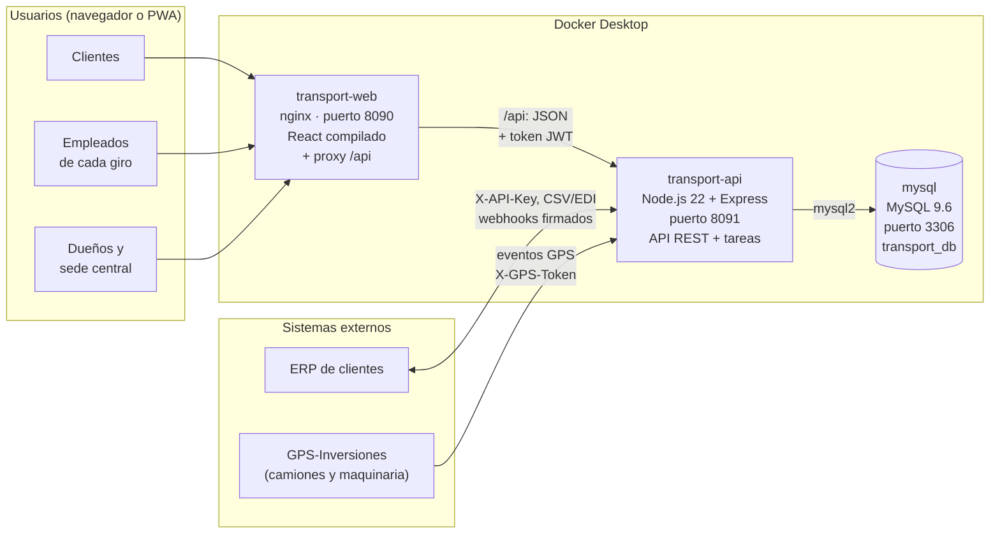
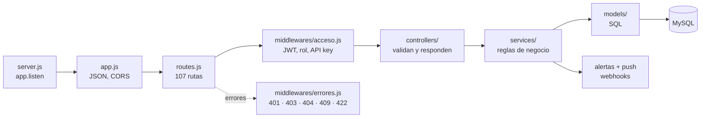
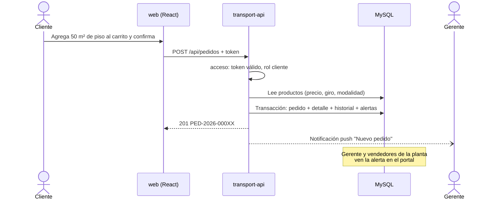
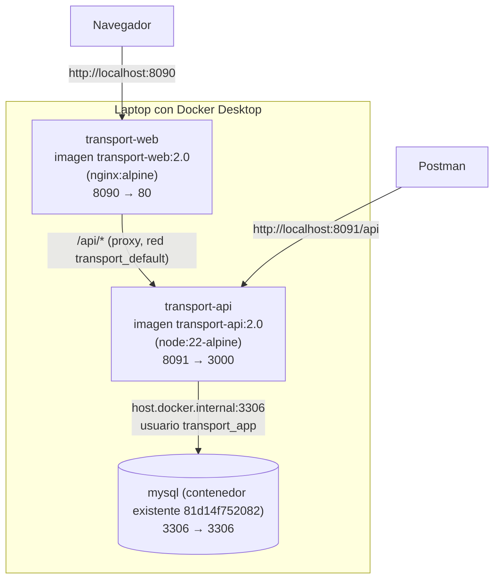

# Arquitectura del sistema TransPort

## 1. Resumen

TransPort tiene seis giros de negocio (extracción minera, procesamiento de materia prima, venta y alquiler de maquinaria, transporte de materia prima, transporte de productos y servicios de construcción) que hoy llevan sus procesos a mano. La solución es **una sola plataforma web** con:

- un **sitio web público** que funciona como sala de ventas de cada giro,
- un **portal** para clientes y empleados, instalable en celular y escritorio como **PWA**,
- una **API REST** que concentra las reglas de negocio de todos los giros,
- una **base de datos MySQL** con los datos separados por giro,
- y **contenedores Docker** para desplegarla igual en cualquier equipo.

| Capa | Tecnología | Carpeta |
|---|---|---|
| Presentación | React 19 + Vite 8 (SPA), React Router, Leaflet (mapas), PWA con service worker; servida por nginx | `web/` |
| Lógica de negocio | API REST en Node.js 22 + Express 5, `mysql2` (pool de conexiones), JWT, `bcryptjs`, `web-push` | `api/` |
| Datos | MySQL 9.6 en el contenedor `mysql` (base `transport_db`) | `database/` |
| Despliegue | Docker Desktop y Docker Compose (imágenes `transport-api:2.0` y `transport-web:2.0`) | `docker-compose.yml` |

La versión anterior estaba hecha en PHP 8 + PDO con HTML y JavaScript sin framework. Al pasar a Node.js + React se conservaron la base de datos (mismos scripts) y el contrato de la API: las mismas rutas, permisos y formato JSON, ahora con los **107 endpoints implementados**.

## 2. Vista general



## 3. Estilo de arquitectura

**Cliente-servidor en tres capas** con una **API REST como monolito modular**:

- Un solo despliegue de la API, con un módulo por proceso común (autenticación, clientes, pedidos, alertas, mensajería, reportes, integraciones) y un módulo por giro (maquinaria, transporte, GPS, producción, construcción).
- Todos los módulos comparten la base de datos y la sesión, pero **cada registro lleva su `giro_id`**: cada giro tiene su propio control (catálogo, inventario, pedidos, presupuesto) y la sede central consolida todo.
- Se eligió un monolito modular y no microservicios porque el equipo es pequeño y hay un solo servidor. Si un módulo crece (por ejemplo el GPS), se puede separar después sin cambiar el contrato de la API.
- La web es una **SPA**: nginx entrega siempre el mismo `index.html` y React Router decide qué página mostrar; todos los datos llegan de la API en JSON.

Dentro de la API, cada petición atraviesa las mismas capas:



| Capa | Responsabilidad | Ejemplo |
|---|---|---|
| `server.js` y `app.js` | Arranque, lectura de JSON y CSV, CORS, cierre ordenado (SIGTERM de Docker) | `app.listen(3000)` |
| `routes.js` | Relaciona método + ruta + grupo de acceso + controlador; arma el catálogo que usan `/api/salud`, el 405 y la documentación | `ruta('patch', '/pedidos/:id/estado', AUTENTICADO, Pedidos.cambiarEstado)` |
| `middlewares/acceso.js` | Verifica el token y el rol (o la API key, o el token del GPS) antes del controlador | Solo Gestión asigna vendedores |
| `controllers/` | Leen filtros y cuerpo, llaman al servicio y devuelven JSON; no tienen reglas de negocio | `controllers/pedidos.js` |
| `services/` | Reglas: flujos de estado, permisos por giro, inventario, alertas, transacciones, webhooks | `services/pedidos.js` → `cambiarEstado` |
| `models/` | SQL con parámetros (`?`); nada de lógica | `models/pedidos.js` → `listar` |
| `lib/` | Utilidades: validación de entradas, respuestas HTTP, formato de fechas y quetzales, CSV | `validar(req.body, { correo: 'requerido\|correo' })` |
| `jobs/` | Tareas programadas dentro del mismo proceso | Recordatorios cada minuto |

**Transacciones:** `db.js` guarda la conexión de la transacción en `AsyncLocalStorage`; así los modelos no reciben la conexión como parámetro y todo lo que ocurre dentro de `transaccion(async () => ...)` se confirma o se revierte junto (pedido, detalle, historial, inventario y alertas). Los avisos que salen del sistema (push y webhooks) se envían con `despues()`, solo cuando la transacción ya se confirmó.

Recorrido de un pedido en línea:



## 4. Composición de archivos

```text
Proyecto Final/
├── README.md                    Guía rápida y demo
├── comandos.txt                 Comandos de Docker (PowerShell) para la demo
├── docker-compose.yml           Servicios api (Node) y web (nginx)
├── .env / .env.example          MySQL, secreto JWT, llaves VAPID, token GPS y puertos
├── database/                    Scripts que se ejecutan en el contenedor de MySQL
│   ├── 01_esquema.sql           35 tablas y 2 vistas
│   ├── 02_datos_demo.sql        Giros, sedes, catálogo, usuarios y cerca de seis meses de operaciones
│   └── 03_usuario_app.sql       Usuario transport_app con permisos solo de datos
├── api/                         Backend: API REST en Node.js + Express
│   ├── Dockerfile               node:22-alpine, npm ci, usuario sin privilegios
│   ├── package.json             express, mysql2, jsonwebtoken, bcryptjs, web-push
│   ├── src/
│   │   ├── server.js            Arranca el servidor y las tareas programadas
│   │   ├── app.js               Express: JSON, CSV, CORS, rutas y errores
│   │   ├── config.js            Variables de entorno
│   │   ├── db.js                Pool de mysql2, transacciones y utilidades SQL
│   │   ├── routes.js            Las 107 rutas con su grupo de acceso
│   │   ├── middlewares/         acceso.js (JWT, roles, API key, token GPS), errores.js
│   │   ├── controllers/         20 controladores (uno por módulo)
│   │   ├── services/            Reglas de negocio: pedidos, pedidosInternos, reuniones, mensajes,
│   │   │                        maquinaria, transporte, gps, produccion, proyectos, finanzas,
│   │   │                        inventario, edi, alertas, push, webhooks
│   │   ├── models/              SQL por tema: catalogo, usuarios, clientes, pedidos, inventario,
│   │   │                        maquinaria, transporte, gps, operaciones, reportes, integraciones...
│   │   ├── jobs/index.js        Recordatorios y revisión diaria
│   │   └── lib/                 validar.js, http.js, formato.js, csv.js
│   ├── scripts/simular-gps.js   Simula GPS-Inversiones: un camión por la CA-9 y dos máquinas
│   └── pruebas/probar_api.mjs   356 verificaciones de los 107 endpoints
├── web/                         Frontend: React + Vite, instalable como PWA
│   ├── Dockerfile               Compila con Node y sirve dist/ con nginx (dos etapas)
│   ├── nginx.conf               Archivos estáticos, rutas de React y proxy de /api
│   ├── vite.config.js           Plugin que genera el service worker; proxy /api en desarrollo
│   ├── index.html
│   ├── public/                  manifest.webmanifest e íconos
│   └── src/
│       ├── main.jsx, App.jsx    Proveedores y rutas (páginas cargadas bajo demanda)
│       ├── sw.js                Service worker: sin conexión y notificaciones push
│       ├── estilos.css          Diseño adaptable (celular, tableta y escritorio)
│       ├── contexto/            sesion.jsx, carrito.jsx, avisos.jsx
│       ├── lib/                 api.js (fetch + token), formato.js, permisos.js, useDatos.js
│       ├── componentes/         Modal, Mapa (Leaflet), Graficas, Productos, Pwa, comunes
│       └── paginas/
│           ├── sitio/           Inicio, Catálogo, Giro, Maquinaria, Carrito, Ingresar, Restablecer
│           └── portal/          Panel, Alertas, Pedidos, Pedidos entre giros, Reuniones, Mensajes,
│                                Clientes, Inventario, Productos, Producción, Alquileres, Viajes,
│                                GPS, Proyectos, Presupuesto, Reportes, Usuarios, Integraciones, Perfil
└── docs/
    ├── arquitectura.md          Este documento
    ├── endpoints.md             Los 107 endpoints, reglas y ejemplos
    ├── base-de-datos.md         Modelo de datos y flujos de estado
    ├── diagramas/               Los diagramas en PNG para la presentación
    └── TransPort.postman_collection.json
```

## 5. Frontend (React + Vite)

- **Rutas:** el sitio público (`/`, `/catalogo`, `/giros/:id`, `/maquinaria`, `/carrito`, `/ingresar`) y el portal (`/portal/...`), que exige sesión y regresa a la página pedida después de iniciarla. Cada página se carga bajo demanda (`lazy`), así la primera carga es liviana.
- **Menú según el rol y el giro:** el cliente ve sus pedidos, alquileres, viajes, proyectos y estado de cuenta; el personal ve lo de su giro (producción en minería y proceso, flota y GPS en maquinaria y transporte, proyectos en construcción); la sede central ve todo, con el reporte consolidado.
- **Estado:** tres contextos de React. `sesion` guarda el token y el usuario, revisa las alertas cada minuto y cierra la sesión si la API responde 401; `carrito` arma pedidos de un solo giro (como exige la API); `avisos` muestra mensajes breves.
- **Datos:** `lib/api.js` agrega el token y convierte los errores de la API en mensajes; el hook `useDatos` carga una ruta y puede repetir la consulta (por ejemplo, el seguimiento de un viaje en ruta cada 20 segundos).
- **Mapas y gráficas:** Leaflet con OpenStreetMap para la flota, los viajes y los recorridos GPS; las gráficas del panel y los reportes son componentes propios en SVG, acompañados siempre de su tabla.
- **PWA:** `manifest.webmanifest` + `sw.js`. Al compilar, un plugin de `vite.config.js` escribe en el service worker la lista de archivos (con su hash) y una versión nueva. Estrategias: la API va primero a la red y, sin conexión, muestra la última respuesta guardada; las páginas abren `index.html` desde la caché; los archivos salen de la caché. El mismo service worker recibe las notificaciones push y, al tocarlas, abre la página relacionada.
- **Desarrollo:** `npm run dev` en `web/` (Vite en el puerto 5173 con proxy de `/api` al puerto 3000) y `npm run dev` en `api/` (reinicia al guardar).

## 6. Cómo responde a cada requerimiento del caso

| Requerimiento | Solución |
|---|---|
| Control propio de cada giro | `giro_id` en catálogo, inventario, pedidos, sedes, flota y presupuesto; el personal solo ve su giro y la sede central consolida |
| Pedidos en línea o reunión con vendedor | `modalidad_venta`: `en_linea` se pide desde el carrito; `cotizacion` agenda reunión y el gerente asigna vendedor |
| Pedidos entre giros | `pedidos_internos` con flujo proveedor/solicitante, alertas y movimientos de inventario en ambas sedes |
| Alertas según el rol | `services/alertas.js` avisa a gerentes, vendedores, administrativos, pilotos, clientes o sede central según el evento, en el portal y por push |
| Recordatorios y notificaciones push | Recordatorios programables (una vez, diario, semanal, mensual) y Web Push con llaves VAPID |
| Sitio web como sala de ventas | Sitio público con los giros, el catálogo, la flota de maquinaria y el carrito |
| PWA (iOS, Android y escritorio) | Manifiesto, service worker y botón Instalar; funciona sin conexión con los últimos datos |
| Seguimiento del cliente | Portal: pedidos, alquileres, viajes con mapa, proyectos con avance y estado de cuenta |
| Comunicación cliente–empresa | Conversaciones por giro con mensajes no leídos |
| Maquinaria: venta y alquiler | Disponibilidad por fechas sin traslapes, entrega, devolución con cobro de atraso |
| Transporte y GPS-Inversiones | Viajes por tipo de ruta, posición y recorrido en el mapa, alertas de velocidad, uso no autorizado y fuera de horario |
| Producción y construcción | Extracción por turno, órdenes de producción con consumo de materia prima, proyectos con avance esperado según el plazo |
| Presupuesto por giro | Presupuesto mensual (general y por categoría) con alertas al 80 % y al 100 % |
| Reportes para decidir | Consolidado de los seis giros, reporte por giro, ventas, presupuesto anual, estado de cuenta y exportación a Excel (CSV) |
| Integración con terceros | API REST con API keys, webhooks firmados con HMAC e intercambio de archivos CSV (EDI), con bitácora |
| Despliegue con Docker | `docker-compose.yml` con dos imágenes propias + los scripts SQL reproducibles |

## 7. Roles y permisos

| Rol | Qué hace |
|---|---|
| `dueno`, `admin_general` (sede central) | Ven todos los giros; reporte consolidado; usuarios, presupuestos, sedes, giros e integraciones (API keys, webhooks, bitácora) |
| `gerente` | Gestiona su giro: catálogo, inventario, pedidos, vendedores, pedidos entre giros, flota, viajes, órdenes, proyectos, gastos y reportes del giro |
| `administrativo` | Lo mismo que el gerente en su giro, salvo listar al personal |
| `vendedor` | Atiende pedidos y reuniones de su giro (`?mios=1`), registra clientes y pedidos a su nombre, responde mensajes |
| `operativo` | Operador de planta: registra la extracción y la producción. Piloto: inicia y entrega solo sus viajes |
| `cliente` | Pide en línea, reserva maquinaria, agenda reuniones, escribe a la empresa y da seguimiento a pedidos, viajes y proyectos |
| Sistema de un cliente | Con su API key consulta y crea pedidos y sigue sus viajes (`/api/externo`) |

## 8. Seguridad

- Contraseñas con bcrypt (`bcryptjs`); nunca se guardan ni se devuelven en texto. El enlace para restablecerlas es de un solo uso, vence en 30 minutos y en la base solo queda su hash SHA-256.
- Sesión con JWT HS256 firmado con `JWT_SECRET`, que vence en 8 horas. En cada petición se vuelve a leer el usuario: una cuenta desactivada o con otro rol pierde el acceso de inmediato.
- Todas las consultas usan parámetros (`?`) de `mysql2`, sin concatenar datos del usuario (sin inyección SQL). Las entradas pasan por `lib/validar.js` (tipos, largos, fechas, listas de valores).
- React escapa todo lo que muestra (protección contra XSS).
- API keys de terceros: se muestran una sola vez y se guarda su hash SHA-256; cada una tiene permisos (`pedidos:leer`, `pedidos:crear`, `viajes:leer`) y solo ve los datos de su cliente. Los webhooks van firmados con HMAC-SHA256.
- La API se conecta con `transport_app`, que solo puede leer y escribir datos (no puede borrar ni cambiar tablas). El contenedor de la API corre con el usuario `node`, no como root.
- Errores sin detalles técnicos cuando `APP_DEBUG=0`.
- En producción la web y la API deben servirse con HTTPS (proxy inverso o túnel); también lo exige el navegador para instalar la PWA y recibir notificaciones push fuera de `localhost`.

## 9. Tareas programadas

`jobs/index.js` corre dentro del proceso de la API (se apaga con `TAREAS=0`) y revisa cada minuto:

- **Recordatorios:** los que ya llegaron a su hora se envían como alerta y notificación push; los que se repiten se reprograman.
- **Revisión diaria (7:00):** alquileres vencidos, máquinas que hay que entregar hoy, productos bajo la existencia mínima por giro, proyectos con el plazo vencido y reuniones de mañana. Cada aviso se envía una sola vez al día.

## 10. Despliegue con Docker



- **Dos imágenes propias.** `api/Dockerfile` instala solo las dependencias de producción (`npm ci --omit=dev`) sobre `node:22-alpine` y corre como el usuario `node`. `web/Dockerfile` tiene dos etapas: la primera compila React con Vite y la segunda copia solo `dist/` a `nginx:alpine`, así la imagen final no lleva Node ni el código fuente.
- **Mismo origen.** La web y la API se ven en `http://localhost:8090` y `http://localhost:8090/api`: nginx reenvía `/api` al contenedor de la API por la red interna de Docker. No hay problemas de CORS y basta un enlace HTTPS (por ejemplo un túnel de Cloudflare al puerto 8090) para instalar la PWA en el celular. El puerto 8091 queda para Postman y otros sistemas.
- **MySQL.** La API llega al contenedor de MySQL por `host.docker.internal:3306`, porque ese contenedor publica el puerto 3306 en la PC. `docker-compose.yml` cambia `DB_HOST` a ese nombre; el mismo `.env` sirve para correr la API fuera de Docker con `DB_HOST=127.0.0.1`.
- **Salud.** Ambas imágenes tienen `HEALTHCHECK`; la API se marca *unhealthy* si `/api/salud` no puede consultar MySQL.
- **Configuración.** Todo está en `.env`. En otro equipo basta con copiar la carpeta, ejecutar los tres scripts de `database/` y `docker compose up -d --build`.

## 11. De PHP a Node.js + React

| PHP (versión 1) | Node.js + React (versión 2) |
|---|---|
| `api/public/index.php` (front controller) | `api/src/server.js` y `app.js` (Express) |
| `api/routes/api.php` | `api/src/routes.js` con `express.Router()` |
| `Core/Auth.php` + `Core/Jwt.php` | `middlewares/acceso.js` con `jsonwebtoken` |
| `Core/Validator.php` | `lib/validar.js` (mismas reglas) |
| `Core/Database.php` (PDO) | `db.js` con el pool de `mysql2/promise` y `AsyncLocalStorage` |
| `Controllers/`, `Services/`, `Models/` | `controllers/`, `services/`, `models/` (mismas reglas) |
| `web/` con HTML y JavaScript por página | `web/` con React + Vite: páginas, componentes y contextos |
| `php:8.4-apache` con el código montado | `node:22-alpine` y `nginx:alpine` con el código dentro de la imagen |
| 30 de 100 endpoints | 107 de 107 endpoints |

Se conservaron sin cambios de fondo: `database/` (se agregaron dos columnas para restablecer contraseñas y una llave única para las suscripciones push), las rutas y el formato JSON de la API, los usuarios de demostración y la forma de levantarlo con `docker compose`.
