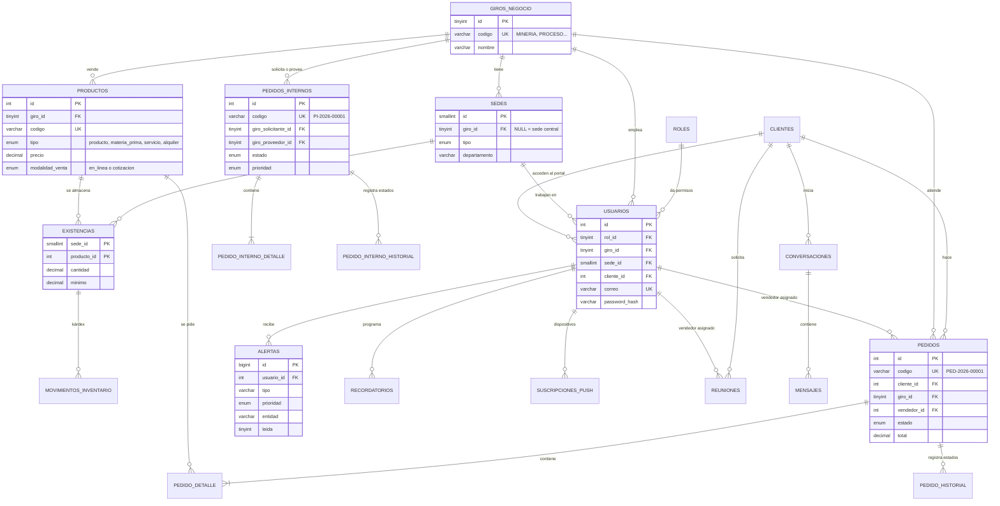
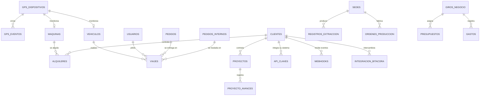
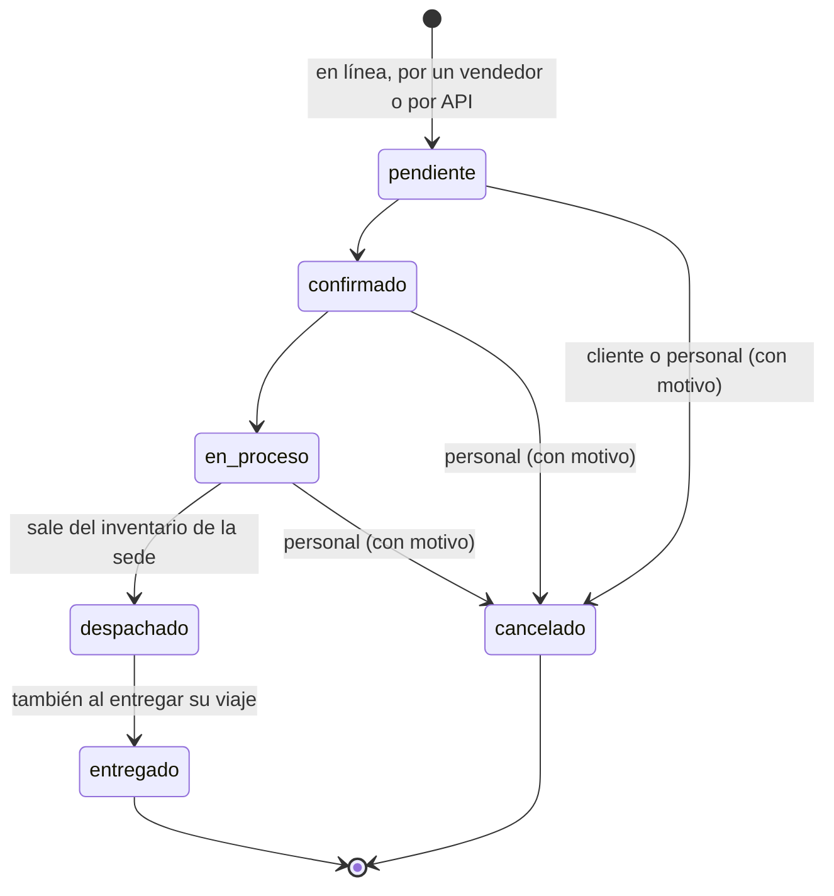
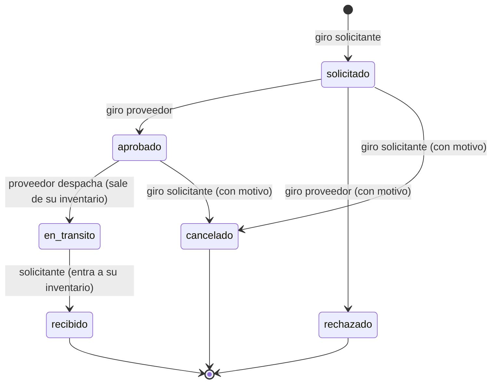
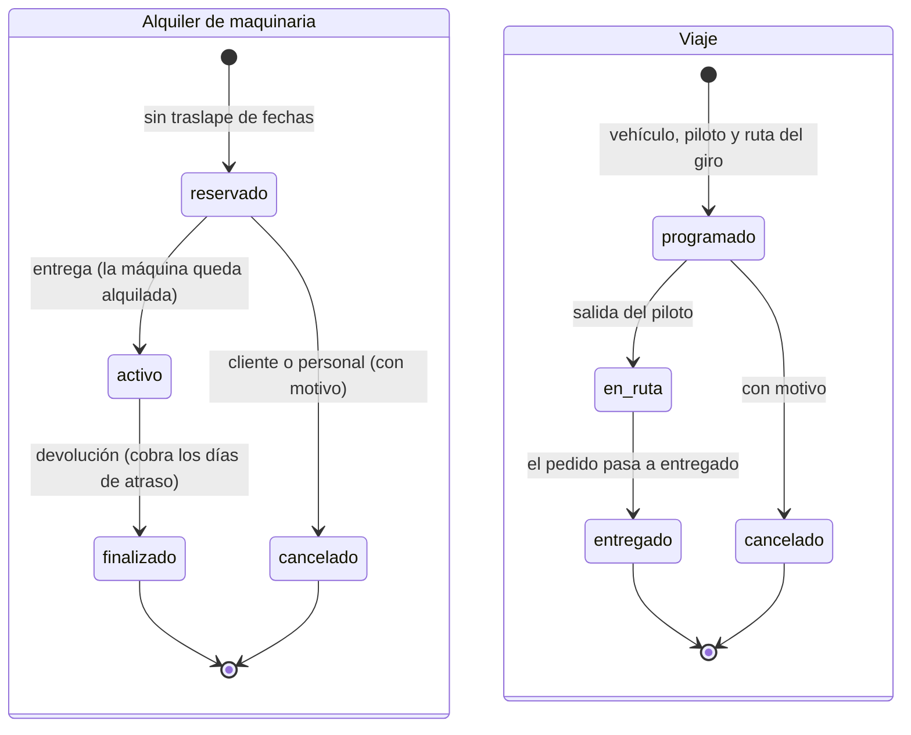

# Base de datos `transport_db`

MySQL 9.6 (también funciona en MySQL 8), juego de caracteres `utf8mb4`. El esquema cubre **todos los módulos** del sistema: 35 tablas y 2 vistas, y la API los usa todos.

| Script | Contenido |
|---|---|
| `database/01_esquema.sql` | Borra y vuelve a crear `transport_db` con todas las tablas, llaves, índices, restricciones `CHECK` y vistas |
| `database/02_datos_demo.sql` | Datos ficticios: 6 giros, 15 sedes, 25 productos, 22 usuarios, 6 clientes y cerca de seis meses de operaciones (71 pedidos, 120 viajes, 48 alquileres, gastos y presupuestos mensuales, extracción, proyectos con avances) |
| `database/03_usuario_app.sql` | Usuario `transport_app` que usa la API, solo con `SELECT, INSERT, UPDATE, DELETE` |

Volver a ejecutar los tres scripts deja la base como al inicio (paso 2 de `comandos.txt`). Las fechas de los datos de demostración se calculan desde el día en que se cargan, así los reportes del mes siempre tienen datos.

## Núcleo comercial

## Operación de los giros, finanzas e integraciones

## Tablas por módulo

| Módulo | Tablas | Endpoints que las usan |
|---|---|---|
| Empresa y seguridad | `roles`, `giros_negocio`, `sedes`, `usuarios`, `clientes` | `/auth`, `/usuarios`, `/roles`, `/giros`, `/sedes`, `/clientes` |
| Catálogo e inventario | `productos`, `existencias`, `movimientos_inventario` | `/productos`, `/inventario` |
| Pedidos de clientes | `pedidos`, `pedido_detalle`, `pedido_historial` | `/pedidos`, `/externo/pedidos` |
| Pedidos entre giros | `pedidos_internos`, `pedido_interno_detalle`, `pedido_interno_historial` | `/pedidos-internos` |
| Alertas y comunicación | `alertas`, `recordatorios`, `suscripciones_push`, `reuniones`, `conversaciones`, `mensajes` | `/alertas`, `/recordatorios`, `/notificaciones`, `/reuniones`, `/conversaciones` |
| GPS, maquinaria y transporte | `gps_dispositivos`, `gps_eventos`, `maquinas`, `alquileres`, `vehiculos`, `viajes` | `/gps`, `/maquinas`, `/alquileres`, `/vehiculos`, `/viajes` |
| Producción y construcción | `registros_extraccion`, `ordenes_produccion`, `proyectos`, `proyecto_avances` | `/produccion`, `/proyectos` |
| Presupuesto | `presupuestos`, `gastos` | `/presupuestos`, `/gastos`, `/reportes` |
| Integraciones | `api_claves`, `webhooks`, `integracion_bitacora` | `/integraciones`, `/externo` |
| Vistas para reportes | `vw_ventas_por_giro_mes`, `vw_presupuesto_vs_gasto` | Consultas de apoyo para reportes |

## Reglas que cuida la base de datos

- Llaves foráneas en todas las relaciones; el detalle y el historial se borran junto con su pedido (`ON DELETE CASCADE`).
- `CHECK`: precio no negativo, cantidades mayores que cero, un pedido interno no puede pedirse al mismo giro, mes entre 1 y 12, avance entre 0 y 100, la fecha de fin de un alquiler no puede ser anterior a la de inicio.
- Valores únicos: códigos `PED-`, `PI-`, `ALQ-`, `VIA-`, `OP-` y `PRY-`; correo de usuario, NIT de cliente, código de producto y de máquina, placa de vehículo, código del dispositivo GPS (y un GPS por máquina o camión), un presupuesto por giro, mes y categoría, y una suscripción push por dispositivo.
- Índices en las consultas frecuentes: pedidos por giro y estado, alertas no leídas por usuario, eventos GPS por dispositivo y fecha, movimientos de inventario por sede y fecha, gastos por giro y fecha.

## Reglas que cuida la API

Lo que depende del rol o de varios registros a la vez se valida en `api/src/services/`, siempre dentro de una transacción:

- **Inventario:** ninguna salida deja la existencia en negativo; al despachar un pedido sale de la sede indicada; en un pedido entre giros sale de la sede proveedora al despachar y entra a la solicitante al recibir; la extracción y la producción entran al inventario de su planta y los consumos de materia prima salen. Cada cambio queda en `movimientos_inventario`.
- **Alquileres:** una máquina no se reserva dos veces en fechas que se traslapan (la reserva bloquea la fila de la máquina con `FOR UPDATE`).
- **Presupuesto:** cada gasto compara lo gastado del mes contra el presupuesto general y el de su categoría, y avisa al cruzar el 80 % y el 100 %.
- **Reportes:** en el consolidado las ventas entre giros no se suman como ingresos de la corporación (se muestran aparte, como ingresos internos); el ingreso de construcción se calcula por el avance de cada obra multiplicado por el monto del contrato.

## Flujos de estado

Pedido de cliente:

Pedido entre giros:

Alquiler de maquinaria y viaje:

